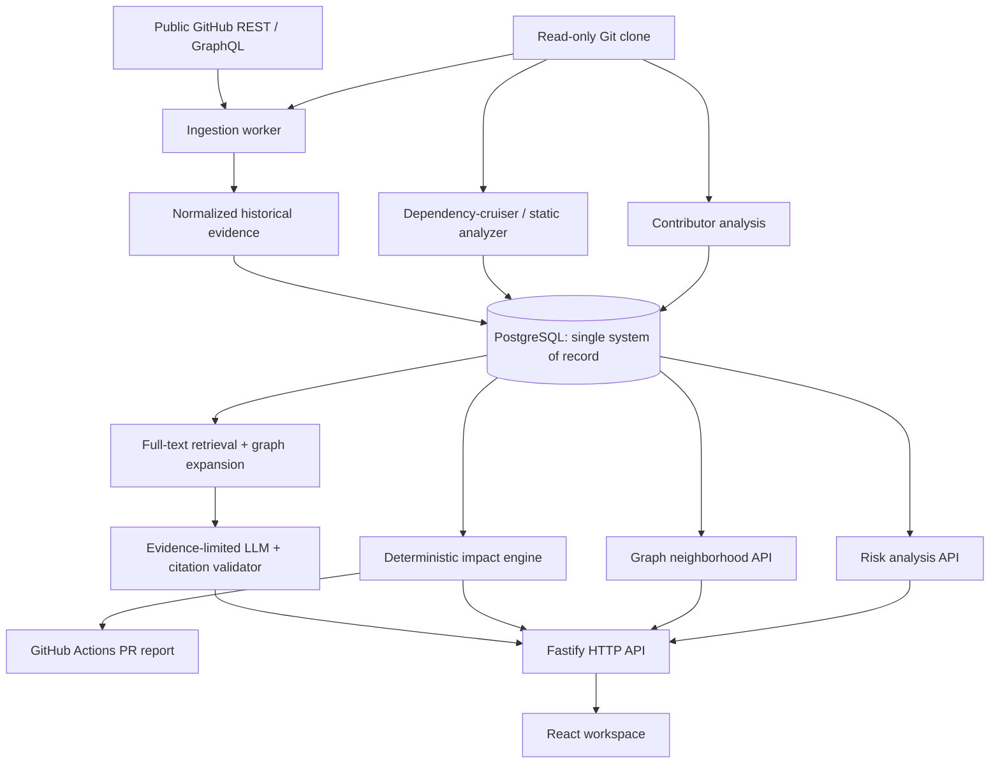
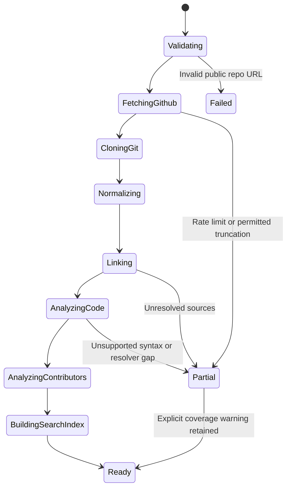
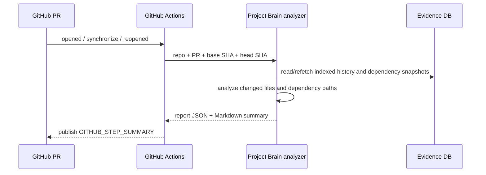

# PROJECT BRAIN
## INNOVISTA PS 06 | Official Problem Statement + Consolidated Backend Engineering Specification

**Document type:** Single-source-of-truth engineering handoff  
**Version:** 1.0 | 30 October 2026  
**Event:** INNOVISTA, 36-hour hackathon  
**Team:** 5 engineers  
**Delivery commitment:** All 4 mandatory capabilities and all 3 bonus capabilities  
**Primary source:** Organizer's `PS.pdf`, pages 16-17 (overall event rules on page 2)  
**Research incorporated:** Both independent Project Brain research briefs supplied in this conversation, plus spot-checks of public repository documentation.

> **Status legend**
> - **[OFFICIAL]**: Organizer's requirement as stated in the uploaded PS, or a faithful condensation.
> - **[LOCKED]**: Our chosen implementation decision, not a requirement imposed by the organizer.
> - **[PROPOSED]**: Specific execution technique or enhancement that can change after a technical test.
> - **[EVALUATE]**: Third-party software or design whose integration has not yet been validated in our stack.
> - **[NON-GOAL]**: Not necessary to meet the scope of this 36-hour version.
>
> **Important:** This is a complete implementation *specification*, not a claim that the application or its integrations have already been built, deployed or tested. We have not independently executed the candidate engines against our selected repository yet. License and compatibility checks must be repeated against the exact versions we install.

---

# 1. One-page engineering decision

## 1.1 The product in one sentence

**Project Brain is an evidence-backed delivery-memory system that explains why code changed, traces the real sources behind that explanation, and shows what existing code or features might be affected by a proposed change.**

Unlike a generic repository chatbot, it unites historical provenance and code-dependency analysis in one inspectable workflow:

1. **Find the history:** issue, PR, review discussion, commit, document, contributor.
2. **Explain the decision:** only when actual source evidence supports the explanation.
3. **Inspect today's structure:** code files and resolvable dependencies at a named Git revision.
4. **Assess a change:** list direct and transitive dependents, relevant historical co-change signals, and uncertainty.
5. **Act on it:** view the graph, see knowledge-concentration risks, and automatically publish PR impact summaries.

## 1.2 Locked implementation baseline

| Layer | Final baseline | Why |
|---|---|---|
| Supported repository source | **Public GitHub repositories** | Explicitly allowed as substitutes for dispersed team systems |
| Supported code languages | **JavaScript / TypeScript / JSX / TSX** | Strong, well-understood deterministic dependency tooling within 36 hours |
| Frontend | **React + TypeScript + Vite** | Fast independent UI development and straightforward API integration |
| Styling and UI | Tailwind CSS + carefully selected shadcn/ui primitives + custom components | Speed without generic-looking output |
| Main backend | **Node.js + TypeScript + Fastify** | Shared types and a single primary runtime for the team |
| API schemas | **Zod** + shared DTO package | Validated requests, responses and source metadata |
| GitHub integration | **Octokit** (REST, selective GraphQL) | Authoritative issue, PR, commit and review relationships |
| Git repository analysis | **Native Git CLI** through safe argument-vector process execution | Commit lineage, changed files, authors, renames and blame |
| Code graph | **dependency-cruiser JSON** | File imports and reverse-dependency analysis for JS/TS |
| Persistent system of record | **PostgreSQL** | One database for indexed evidence, graph edges, jobs and analysis results |
| Full-text retrieval | **PostgreSQL full-text search** | Explainable baseline without requiring an embedding service |
| Optional semantic retrieval | **pgvector** behind a feature flag | Better recall only if model/embedding integration is working |
| Background jobs | **pg-boss** | Durable ingestion and reindex orchestration without Redis |
| LLM | Provider-neutral adapter, one configured provider at runtime | Can change model providers without changing the evidence pipeline |
| Graph visualization | **Cytoscape.js** | Interactive graph neighborhoods, filtering and edge inspection |
| PR automation | **GitHub Actions `pull_request` workflow** | Actual automatic checks, read-only by default |
| Reproducible delivery | **Docker Compose + pinned lockfiles** | Easy clean-start demo and fewer environment surprises |

**Architecture choice resolved:** This document adopts the TypeScript/Fastify baseline rather than simultaneously developing a FastAPI backend. Python analytics or native MCP engines may be isolated behind an adapter **only** if they pass the short integration experiment described below. There must be exactly **one authoritative graph/evidence model** exposed by our backend.

## 1.3 What's different about this build

Our differentiator is not an unprecedented code graph or an AI model. Existing tools do both. Our differentiator is **decision provenance joined to structural change impact**, with inspectable verified and inferred relationships. Every graph edge should answer: *Where did you learn this relationship?* Every impact result should answer: *Why could this file be affected?*

---

# 2. Official INNOVISTA PS 06: faithful requirements

## 2.1 Identity and framing [OFFICIAL]

**Problem Statement 06:** *The Institutional Amnesia Problem: Project Brain*  
**Focus area:** AI | Knowledge Management | Developer Tools  
**Organizer's description:** A delivery-memory system that remembers why code was written and what could break when it changes.

### Background and gap

As projects grow, their reasoning and delivery history scatter across Git commits, Jira tickets, Slack threads and Confluence documents. When senior developers leave, important context may disappear. Remaining developers struggle to understand why a design exists and what its blast radius might be if changed.

### Official challenge, condensed without adding requirements

Build an intelligent **delivery-memory system** that connects project history so engineers can ask complicated design questions and examine the possible impact of new code changes, without depending on a particular person's recollection.

### Intended users [OFFICIAL]

- New team members learning an unfamiliar codebase.
- Developers and technical leads preparing changes or reviews.
- Testers deciding which parts of a system need rechecking.

## 2.2 Mandatory functions [OFFICIAL]

The PDF's "Minimum Working Version" list begins with three items on page 16 and continues with **Impact Check** on page 17. We must deliver all **four**.

| ID | Requirement | Faithful interpretation | Our completion proof |
|---|---|---|---|
| M1 | **Project History Collection** | Gather project history from commits, tickets, chats and documents. A public open-source project's commits, issues and PRs may serve as the stand-in. | Import a public repo; capture real commits, issues, PRs, their discussions and documentation. |
| M2 | **Connected Memory** | Link related records so the user can follow history between items. | Traverse a genuine `Issue -> PR -> Commit -> File` path or another evidence-supported path. |
| M3 | **Question Answering** | Answer questions such as "Why was this code written this way?" and show supporting sources. | Evidence-backed response with links to actual GitHub entities; refuse unsupported claims. |
| M4 | **Impact Check** | Given a proposed change, list files, features or components that might be affected, with a reason for each. | Run actual dependency traversal and present the path/reason for every affected item. |

## 2.3 All three bonus functions [OFFICIAL; INCLUDED IN OUR SCOPE]

| ID | Organizer's bonus | Our implementation commitment |
|---|---|---|
| B1 | **Visual map** connecting code, tickets and people | Data-driven interactive graph with source inspection, filters and bounded expansion. |
| B2 | **Pull request check** that automatically shows change impact | Real GitHub Actions trigger on new or updated PR and an actual per-run impact report. |
| B3 | **Knowledge at risk** for code only one person has worked on | Identify files with one distinct observed historical contributor and display underlying Git evidence and index coverage. |

## 2.4 Official constraints [OFFICIAL]

1. **Cite sources.** Answers must point to the commit, ticket or message on which they are based.
2. **Say "not found."** If no history supports an explanation, do not invent one.
3. **Public or sample data only.** No private project or personal data in the hackathon demonstration.
4. The overall event asks for a genuine running prototype, a short live walkthrough, readable source code with setup instructions and future ideas.
5. The event's general guidelines allow the team to select languages, frameworks, models and databases unless a specific PS restricts them. Results must come from running behavior, not hardcoded answers.

**Not official requirements:** a particular cloud provider, Neo4j, LangChain, multiple LLM agents, Python, a 3D graph, private Slack access, support for every code language, or a scoring benchmark set by the organizers. Do not present our design choices as organizer mandates.

---

# 3. Scope, acceptance and non-goals

## 3.1 Minimum end-to-end product journey [LOCKED]

A judge can paste a public GitHub URL and do the following without hand-seeded application outputs:

1. Import repository history and inspect a truthful progress/coverage indicator.
2. Find a component; navigate to the related commit, PR and issue if the evidence exists.
3. Ask "why" and inspect the sources supporting the answer.
4. Ask an unsupported question and receive an honest "not found" response.
5. Select a file or proposed code change and see computed dependency paths and potential impacts.
6. Explore the same records in an interactive relationship graph.
7. Inspect single-observed-contributor files with their historical evidence.
8. Open or update a real PR in a controlled demo repository and view an automatically produced impact report.

## 3.2 Definition of done: each capability

- **M1:** Persisted public GitHub data; pagination/rate-limit status; indexing SHA and range; incomplete imports explicitly labelled.
- **M2:** Relationship edges contain provenance, source type and verification state; graph survives server restart.
- **M3:** Answer grounded in retrieved source content; every substantive factual claim supported; absent evidence produces a refusal/unknown state.
- **M4:** Real dependency paths with changed file, affected file, hop depth, rationale and blind spots.
- **B1:** Pan/zoom/focus/filter/expand a data-backed graph and inspect any shown relation's source.
- **B2:** Opening or updating a PR triggers a fresh analysis and an Actions job summary. Optional comment is secondary.
- **B3:** Changing actual Git contributor history changes the per-file risk result; show observation window and identity-normalization caveats.

## 3.3 Deliberate non-goals in this 36-hour version [LOCKED]

- No mandatory Jira, Slack, Confluence, private GitHub or enterprise SSO integration.
- No automatic editing or merging of the analyzed project's code.
- No promises of finding *all* runtime dependencies, all architectural reasons or guaranteed breakages.
- No requirement to build an original compiler/parser, graph database or web crawler.
- No second independent backend/database merely because another open-source project uses one.
- No fabricated “AI confidence percentages,” invented source links or prewritten demo responses.

---

# 4. Architecture and execution boundaries

## 4.1 Logical architecture



## 4.2 Runtime boundaries [LOCKED]

**`apps/web`** is a presentation client only. It never holds GitHub secrets, LLM API keys or authoritative graph logic.

**`apps/api`** serves authenticated/validated REST APIs, query orchestration, source-aware reasoning, status endpoints and API rate limits. It calls domain services and never generates unverified dependency edges from LLM prose.

**`apps/worker`** executes queued ingestion, Git CLI, static-analysis, contributor and reindex jobs with bounded resources. It runs outside the request-response latency budget.

**`packages/core`** owns domain types and algorithms: entity IDs, typed relationships, impact path traversal, evidence validation and knowledge-risk classification.

**`packages/contracts`** owns Zod request/response schemas shared across frontend and backend.

**`packages/adapters`** wraps third-party tools, making GitHub, Git history, dependency-cruiser and LLM interactions replaceable and testable.

**PostgreSQL** stores canonical records and derived analysis snapshots, including ingestion coverage and tool versions. A local CBM SQLite graph or RepoGraph FalkorDB graph must **not** become the product's competing system of record.

## 4.3 Graph is two distinct evidence domains

- **Historical graph:** `Issue`, `PR`, `Commit`, `Comment`, `Document`, `Person`, `FileRevision` and source-backed links between them.
- **Structural graph:** file-to-file `IMPORTS`/`DEPENDS_ON` edges extracted from source at a particular revision. Optional symbol-level edges later.
- **Cross-graph joins:** changes to files are linked to the historical PRs/commits, enabling a source-backed connection from an old design discussion to today's dependency neighborhood.

**Rule:** `CO_CHANGED_WITH` is an observed historical association, **not** the same as `IMPORTS`. `LLM_RELATED_TO` is a hypothesis, **not** an API-confirmed issue link. These relationships must be visibly distinct in the API and UI.

## 4.4 Indexing snapshot consistency

Every index stores:

- Repository identity and GitHub stable ID.
- Branch and **exact `head_sha`** analyzed.
- History cutoff / observed date window / record limits.
- Analyzer name, version and configuration hash.
- Per-source API coverage (issues, PRs, comments, commits, docs).
- Job status and any warnings.

Graph answers and impacts must say which source revision they refer to. If an open PR has a newer head SHA than the last index, either refresh the structural graph or mark the impact result **stale/partial**. Never pass old graph results off as fresh.

---

# 5. Open-source research merged into implementation choices

## 5.1 Existing complete or near-complete products

| Project | Public repository | Existing relevant work | Decision |
|---|---|---|---|
| **RepoGraph (FalkorDB)** | https://github.com/FalkorDB/RepoGraph | Git-history relationship graph; knowledge silos, bus-factor-like analysis, co-change coupling, change risk and reviewer suggestions. | **[EVALUATE]** Mine algorithms and validate outputs. It requires FalkorDB; not a mandatory backend dependency. |
| **Codebase Memory MCP** | https://github.com/DeusData/codebase-memory-mcp | Persistent code graph; structural relationships, local analysis, change-impact queries and viewer. | **[EVALUATE]** Strong candidate for extending beyond file imports. Test its CLI/MCP export contract first. |
| **WhyGraph** | https://github.com/mtrdesign/whygraph | Historical rationale and source provenance using commits, blame, PRs and issues. | **[EVALUATE]** Reference for historical evidence model; reuse code only after checking its license. |
| **GitNexus** | https://github.com/abhigyanpatwari/GitNexus | Code graph, call chains, diff analysis and impact queries. | **Reference only by default.** PolyForm Noncommercial license; do not assume permissive reuse. |
| **Code Maat** | https://github.com/adamtornhill/code-maat | Historical change coupling, churn, ownership and hotspots. | Algorithmic reference; GPL obligations need review before code integration. |

**Research limitation:** Repository descriptions and published benchmark numbers do not prove local integration, code quality or runtime compatibility. We have not run all of these projects. Do not stack their independent servers into the main architecture without a passing test and a specific, indispensable benefit.

## 5.2 Library/tool decision table

| Concern | Selected | Alternatives / research only |
|---|---|---|
| GitHub API | [Octokit](https://github.com/octokit/octokit.js) | Raw REST and GraphQL calls |
| Commit and author data | Git CLI | [PyDriller](https://github.com/ishepard/pydriller) when a Python worker is justified |
| JS/TS dependency analysis | [dependency-cruiser](https://github.com/sverweij/dependency-cruiser) | [ts-morph](https://github.com/dsherret/ts-morph) for deeper symbols; [Madge](https://github.com/pahen/madge) alternative |
| Language expansion | Not required | [Tree-sitter](https://github.com/tree-sitter/tree-sitter) |
| Relationship persistence | PostgreSQL typed nodes/edges | [Neo4j](https://github.com/neo4j/neo4j) or FalkorDB only if benchmarks justify switch |
| Search | PostgreSQL full-text | [pgvector](https://github.com/pgvector/pgvector) for optional semantic similarity |
| Queue | [pg-boss](https://github.com/timgit/pg-boss) | Redis/BullMQ if already configured and reliable |
| Graph UI | [Cytoscape.js](https://js.cytoscape.org/) | [React Flow](https://github.com/xyflow/xyflow) for curated flows, [Sigma.js](https://github.com/jacomyal/sigma.js) for very large networks |
| Contributors | Native `git log`, `.mailmap`, optional `git blame` | [git-fame](https://github.com/casperdcl/git-fame), [Hercules](https://github.com/src-d/hercules), [Git of Theseus](https://github.com/erikbern/git-of-theseus) for validation/reference |
| Architecture decision docs | Markdown/ADR files from repo | [MADR](https://github.com/adr/madr) patterns |
| Document conversion | Repo Markdown as baseline | [MarkItDown](https://github.com/microsoft/markitdown) for bonus format support |

**License checkpoint:** Confirm exact version and `LICENSE` file in the lockfile/SBOM. Record attribution. A permissive library is not automatically safe to run against arbitrary, untrusted repository content. Never copy unlicensed, noncommercial-restricted or GPL-covered source into our repo without explicit compatibility review.

## 5.3 Three tightly bounded technical spikes

The other research agent correctly emphasized testing tools before architecture lock. We merge that as follows:

| Spike | Timebox | Pass criteria | If it fails |
|---|---|---|---|
| **S1: Provenance** | First 3 hours, in parallel | Real GitHub issue/PR/commit/file path, with valid links and stored IDs | Use another repo with verifiable history; don't invent a link |
| **S2: Structural analysis** | First 3 hours, in parallel | A real JS/TS file import and reverse-dependent path extracted through dependency-cruiser | Fix analyzer setup or change demo repo, not the feature requirement |
| **S3: Alternative engine** | After S1/S2, capped to ~60-90 minutes | Codebase Memory MCP or RepoGraph yields a stable, parsable, directly useful result not cheaply available in baseline | Keep original Git + dependency-cruiser implementation; reference engine only |

**Final build rule:** S1 and S2 are mandatory technical foundations. S3 is an optional acceleration experiment, not a reason to halt the primary architecture. If CBM is integrated, its output becomes an adapter feeding our canonical entities/edges. If RepoGraph is integrated, historical co-change and knowledge metrics become supplemental evidence, never authoritative code imports.

---

# 6. Domain model and relational database

## 6.1 Canonical entity types

`Repository`, `File`, `FileRevision`, `Commit`, `PullRequest`, `Issue`, `DiscussionComment`, `Document`, `Decision`, `Contributor`, `Module`.

Optional later: `Symbol`, `TestFile`, `BuildTarget`, `RuntimeService`, `ADR`, `Review` as separate rich entity types.

## 6.2 Canonical relationship types

| Relationship | Origin | Evidence tier |
|---|---|---|
| `AUTHORED` (Contributor -> Commit) | Git metadata | Verified record |
| `MODIFIED` (Commit -> FileRevision) | Git diff or GitHub PR changed-files API | Verified record |
| `IN_PR` (Commit -> PullRequest) | GitHub commit-to-PR API | Verified record |
| `CLOSES_ISSUE` (PR -> Issue) | GitHub closing-reference metadata | Verified record |
| `REFERENCES` (PR/Issue/Comment -> Issue/PR/Commit) | Explicit link or GitHub relationship | Verified if explicit; otherwise inferred |
| `COMMENTS_ON` (Comment -> PR/Issue) | GitHub discussion thread | Verified record |
| `REVIEWED` (Contributor -> PR) | GitHub review API | Verified record |
| `IMPORTS` (FileRevision -> FileRevision) | Static analyzer output at SHA | Verified *static observation*, not runtime guarantee |
| `CO_CHANGED_WITH` (File -> File) | Shared historical commits | Derived statistical association |
| `DOCUMENTS` (Document -> File/Module) | Explicit path/reference | Verified only with direct reference |
| `DECISION_SUPPORTED_BY` (Decision -> Source) | Extracted rationale and checked cited evidence | Inferred/reviewable unless manually curated |
| `POSSIBLY_AFFECTS` (File -> File) | Reverse dependency traversal | Derived potential impact |

For each edge preserve `source_url`, `source_entity_id`, `extractor`, `verification`, `repository_id`, `snapshot_sha`, `observed_at`, and optional `line_range`/`evidence_excerpt`. A confidence score alone is not provenance.

## 6.3 Proposed PostgreSQL schema [LOCKED logical schema, migration syntax adaptable]

The following is a compact schema contract, not a substitute for migrations and indexes tested against our selected PostgreSQL version:

```sql
CREATE TABLE repositories (
  id UUID PRIMARY KEY,
  github_id BIGINT UNIQUE NOT NULL,
  owner TEXT NOT NULL,
  name TEXT NOT NULL,
  default_branch TEXT,
  visibility TEXT NOT NULL DEFAULT 'public',
  created_at TIMESTAMPTZ NOT NULL DEFAULT now(),
  UNIQUE(owner, name)
);

CREATE TABLE index_snapshots (
  id UUID PRIMARY KEY,
  repo_id UUID NOT NULL REFERENCES repositories(id),
  head_sha TEXT NOT NULL,
  branch TEXT NOT NULL,
  status TEXT NOT NULL,
  coverage JSONB NOT NULL DEFAULT '{}'::jsonb,
  tool_versions JSONB NOT NULL DEFAULT '{}'::jsonb,
  started_at TIMESTAMPTZ NOT NULL DEFAULT now(),
  completed_at TIMESTAMPTZ,
  errors JSONB NOT NULL DEFAULT '[]'::jsonb
);

CREATE TABLE entities (
  id UUID PRIMARY KEY,
  repo_id UUID NOT NULL REFERENCES repositories(id),
  kind TEXT NOT NULL,
  canonical_key TEXT NOT NULL,
  title TEXT,
  source_url TEXT,
  metadata JSONB NOT NULL DEFAULT '{}'::jsonb,
  UNIQUE(repo_id, kind, canonical_key)
);

CREATE TABLE edges (
  id UUID PRIMARY KEY,
  repo_id UUID NOT NULL REFERENCES repositories(id),
  snapshot_id UUID REFERENCES index_snapshots(id),
  from_entity_id UUID NOT NULL REFERENCES entities(id),
  to_entity_id UUID NOT NULL REFERENCES entities(id),
  kind TEXT NOT NULL,
  verification TEXT NOT NULL, -- observed / derived / inferred
  source_url TEXT,
  source_entity_id UUID REFERENCES entities(id),
  extractor TEXT,
  evidence JSONB NOT NULL DEFAULT '{}'::jsonb
);

CREATE TABLE evidence_documents (
  id UUID PRIMARY KEY,
  repo_id UUID NOT NULL REFERENCES repositories(id),
  entity_id UUID NOT NULL REFERENCES entities(id),
  source_url TEXT NOT NULL,
  content_sha TEXT,
  section_locator TEXT,
  body TEXT NOT NULL,
  search_tsv TSVECTOR,
  metadata JSONB NOT NULL DEFAULT '{}'::jsonb
);

CREATE TABLE file_dependencies (
  id UUID PRIMARY KEY,
  repo_id UUID NOT NULL REFERENCES repositories(id),
  snapshot_id UUID NOT NULL REFERENCES index_snapshots(id),
  importing_file TEXT NOT NULL,
  imported_file TEXT NOT NULL,
  dependency_kind TEXT NOT NULL,
  source_line INT,
  evidence JSONB NOT NULL DEFAULT '{}'::jsonb
);

CREATE TABLE file_contributors (
  repo_id UUID NOT NULL REFERENCES repositories(id),
  snapshot_id UUID NOT NULL REFERENCES index_snapshots(id),
  file_path TEXT NOT NULL,
  contributor_key TEXT NOT NULL,
  observed_commits INT NOT NULL,
  first_touch TIMESTAMPTZ,
  last_touch TIMESTAMPTZ,
  PRIMARY KEY(snapshot_id, file_path, contributor_key)
);

CREATE TABLE analysis_runs (
  id UUID PRIMARY KEY,
  repo_id UUID NOT NULL REFERENCES repositories(id),
  snapshot_id UUID REFERENCES index_snapshots(id),
  kind TEXT NOT NULL,
  status TEXT NOT NULL,
  input JSONB NOT NULL,
  output JSONB,
  warnings JSONB NOT NULL DEFAULT '[]'::jsonb,
  created_at TIMESTAMPTZ NOT NULL DEFAULT now()
);
```

Create proper secondary indexes on `entities(repo_id,kind)`, `edges(repo_id,kind,from_entity_id)`, `edges(repo_id,kind,to_entity_id)`, `file_dependencies(snapshot_id,imported_file)`, `evidence_documents USING GIN(search_tsv)`, and `analysis_runs(repo_id,created_at)`. Add uniqueness or transactional upsert rules for ingested GitHub entities, dependency rows and repeat analysis events.

Do not let the UI compute authoritative risk or dependency counts from arbitrarily paginated graph neighborhoods. All calculations happen on the backend against a declared snapshot.

## 6.4 Stable identity rules

- GitHub items: repository identity + stable GitHub node ID or immutable numeric ID.
- Commits: repository identity + complete Git SHA; never shortened SHAs as database keys.
- Files: repository identity + normalized repository-relative path + snapshot SHA; renames linked through Git history where possible.
- Contributors: Git name/email records normalized via `.mailmap` if available; preserve unresolved aliases and avoid merging people solely because their display names match.
- Comments: native GitHub IDs plus source URL and parent relationship.
- Documents: repository path and revision/commit SHA; content-addressed chunk identifiers.

---

# 7. Ingestion and indexing backend

## 7.1 Import pipeline



**Input validation:** Accept only expected GitHub public repository URLs; normalize `owner/repo` server-side. Do not accept arbitrary Git remotes, local file paths, embedded shell commands or unchecked callback URLs. Protect against SSRF and shell injection.

**Fetch GitHub evidence:** Paginate issues, PRs, PR reviews/comments, linked commits, PR changed-files metadata and README/ADR documents. Store original object IDs/URLs, updated timestamps and content hashes. Handle API limits with retry/backoff and a consistent partial-state marker.

**Clone for Git analysis:** Clone a bounded set of commits from an allowlisted public GitHub endpoint in an isolated workspace. Use process `spawn`/`execFile` with explicit arguments, not string-concatenated shell commands. Set CPU, disk, network, clone size and time limits.

**Link evidence:** Use API-confirmed `commit -> PR` and closing issue links where possible. A textual mention such as "related to issue 123" is a reference, not automatically a formal `CLOSES_ISSUE` edge.

**Analyze structure:** Run the pinned static analyzer with controlled configuration. Normalize JSON output to `file_dependencies` and entity edges. Do not execute untrusted repo scripts as part of analyzing it.

**Analyze authors:** Read historical modifications, normalize contributor aliases, and aggregate per-file contributor coverage.

**Index retrieval:** Split issue text, PR descriptions, relevant comments, documentation and commit messages into location-aware chunks. Store full-text search vectors and context IDs; optionally embed after deterministic retrieval works.

**Publish snapshot:** Atomically mark the snapshot ready or partially ready with exact SHA and per-source coverage. Preserve all warnings. Reindex changed content idempotently.

## 7.2 Practical import bounds

Set explicit default caps: repository file count, history depth, GitHub pages, individual document size, concurrent workers, LLM spend and total job time. Actual values should be measured during the first technical spike and made configurable, **not hidden**. The frontend must show which categories are complete and which were limited.

When source coverage is incomplete, the knowledge-risk feature must never claim "only one person ever worked here". It may accurately say "one observed contributor in the indexed history".

---

# 8. Evidence-backed question answering

## 8.1 Retrieval and answer flow

1. Classify the question: design rationale, change history, contributor, architecture or impact.
2. Use PostgreSQL full-text retrieval on preserved source texts; optional vector retrieval only to expand candidate recall.
3. Expand graph neighbors around relevant commits, PRs, issues and files, preferring verified paths.
4. Build a bounded evidence pack with exact source IDs, URLs, snippets, revision and timestamps.
5. Ask the LLM for a structured response whose substantive claims cite provided evidence IDs.
6. Validate each cited ID against the retrieved pack and map it to actual source URLs.
7. Label what is a quoted/documented reason vs. an interpretation vs. an unanswered question.
8. If evidence is missing, return **"No supporting project history found."** Do not silently answer from model memory.

## 8.2 Example backend response contract

```json
{
  "answer": "The available PR discussion records a compatibility concern.",
  "status": "supported",
  "claims": [
    {
      "text": "The change was discussed as a compatibility fix.",
      "evidenceIds": ["evidence:pr-comment:42"],
      "support": "documented"
    }
  ],
  "sources": [
    {
      "id": "evidence:pr-comment:42",
      "kind": "pr_comment",
      "url": "https://github.com/example/project/pull/12#issuecomment-42",
      "locator": "Pull request #12, comment 42"
    }
  ],
  "unknowns": [],
  "snapshotSha": "0123456789abcdef0123456789abcdef01234567"
}
```

**This JSON uses illustrative values, not actual GitHub evidence or a fabricated verified historical claim.**

## 8.3 Guardrails

- LLM cannot directly create `verified` database edges.
- A valid-looking URL is not sufficient proof: cited material must actually support the statement. Validate source existence and perform conservative claim-support checks, with uncertain claims flagged.
- No private data uploads for the hackathon.
- Limit prompt injection from README/issue/PR text by treating all retrieved text as untrusted source content, not instructions.
- Model/API outage: return factual evidence graph and search results; disable only generated synthesis.
- Log exact evidence IDs and response validation results to support demo debugging without exposing secrets.

---

# 9. Deterministic change-impact engine

## 9.1 Two distinct analyses

**Structural impact [LOCKED]:** Given changed file `A`, find files directly or transitively importing `A`. E.g.:

```text
A = src/auth.ts
B = src/session.ts imports A
C = src/dashboard.ts imports B

Proposed change: A
Direct possible impact: B (path B -> A)
Transitive possible impact: C (path C -> B -> A)
```

Structural relationships are deterministic observations from the analyzer at the selected SHA. They indicate plausible affected code, **not** proof of a bug.

**Historical co-change [PROPOSED enhancement included in impact UI]:** Find files that repeatedly appeared in the same commits as the changed file. Report sample size and observation window separately from structural impact. This supplies useful context but is not a substitute for import/dependency analysis.

## 9.2 Algorithm

1. Validate changed paths and the target snapshot SHA.
2. Normalize file renames and filter ignored/vendor/generated paths.
3. Look up reverse dependencies: modules whose `imported_file` equals the changed module.
4. Traverse breadth-first or depth-first up to a bounded maximum depth (e.g., 3 for initial UI).
5. Deduplicate affected paths; retain one or more shortest explanatory paths.
6. Retrieve supporting static edges, past connected changes and relevant historical decisions.
7. Classify into `direct`, `transitive`, `historically_coupled` and `unknown` groups.
8. Return explanations and source evidence, with explicit false-negative limitations.

## 9.3 Non-negotiable edge cases

- Deleted and renamed files.
- `index.ts` barrel exports and path aliases where resolvable.
- Cyclic imports without infinite traversal.
- External imports and unresolved modules.
- Dynamic imports and runtime dependency injection (flag as potential blind spots).
- Stale snapshot versus PR head.
- Generated code and binary assets.
- No data, oversized changes and timeout recovery.

For **features** (rather than files), only label a feature when a real module/route/component mapping exists. Do not fabricate feature-to-code links to impress the judge.

## 9.4 Impact response example

```json
{
  "changedFiles": ["src/auth.ts"],
  "snapshotSha": "0123456789abcdef0123456789abcdef01234567",
  "affected": [
    {
      "file": "src/session.ts",
      "signal": "static_reverse_dependency",
      "depth": 1,
      "path": ["src/session.ts", "src/auth.ts"],
      "impact": "possible",
      "explanation": "session.ts imports auth.ts",
      "evidence": [{"type": "import", "file": "src/session.ts", "line": 4}]
    }
  ],
  "warnings": ["Dynamic runtime dependencies may not be represented."]
}
```

This is a fixture illustrating the API schema, not a measured result.

---

# 10. Bonus B1: interactive connected-memory map

**Backend source of truth:** A paginated bounded-neighborhood query over canonical entities/edges. Do not send an entire huge repo graph on initial page load.

**Required interactions:**

- Select a file, PR, issue, commit, document or contributor.
- Expand one or two relationship hops at a time.
- Filter node/edge type, date, certainty/verification and structural-vs-historical relationship.
- Highlight the evidence path for a result; click an edge to open source proof.
- Jump between the graph, decision timeline, cited answer and impact view without losing selection.
- Display stale/partial index warnings.

**Implementation:** Cytoscape.js renders nodes and edges. Layouts are determined by type and graph size; the backend returns node/edge IDs and evidence links. Use animation to emphasize verified paths, not to imply unverified causality.

**Pass:** Select an actual PR, traverse through one real commit to a changed file, open the exact GitHub source, then inspect that file's current importer relationships.

---

# 11. Bonus B2: automatic pull-request impact check

## 11.1 Real event-driven workflow



**[LOCKED]** The required bonus is satisfied by a genuine automatically generated GitHub Actions run summary. Posting a persistent PR comment is an optional improvement and needs additional permissions; never pretend comments are required by the PS.

## 11.2 Workflow safety

- Use `pull_request` for `opened`, `reopened`, and `synchronize` initially.
- Explicitly set the lowest required `GITHUB_TOKEN` permissions, typically `contents: read` and `pull-requests: read` for read-only analysis.
- No privileged `pull_request_target` checkout of untrusted head code.
- Do **not** run `npm install`, `npm run build`, arbitrary repository-supplied config, postinstall scripts or other untrusted executable code just to analyze the PR.
- If static analysis needs source checkout, inspect repository files as **data** in a restricted environment with trusted, pinned analyzer code/config. A hosted analyzer should accept signed/authenticated event data and enforce limits.
- Use PR number, base SHA and head SHA for idempotency and cache keys.
- Support fork PR restrictions and required approvals; read-only summary is the guaranteed path, while comment publication is best effort.
- If using webhooks instead of GitHub Actions, verify HMAC signatures and enforce replay protection.

GitHub's workflow documentation specifically warns about untrusted fork code and sensitive permissions in `pull_request_target` workflows. Reference: https://docs.github.com/en/actions/reference/security/securely-using-pull_request_target

## 11.3 PR check payload

Report the changed files, direct/transitive dependents, relevant historical decisions, tests or areas worth inspecting when evidence exists, index freshness and limitations. The check must be different when the PR diff changes. Never create one fixed sample report and pass it off as an analysis.

**Pass:** Open a PR in a controlled public demo repository, observe the first report, update its files, and observe a refreshed report with a different input SHA and appropriately updated impact paths.

---

# 12. Bonus B3: knowledge-at-risk and contributor concentration

## 12.1 Official minimum versus our richer view

The official bonus says to **highlight code that only one person has ever worked on**. We should implement that directly using distinct observed historical authors for each file. Our richer display may also show contributor concentration, recent review participation and frequently changed modules, but these are extra interpretations.

## 12.2 Proposed computation

- Use `git log --follow` where practical and bounded, plus modification records for contributors and file renames.
- Resolve aliases via `.mailmap` when available; retain uncertain aliases separately.
- For each file, count distinct authors of observed modifications in the indexed history.
- `observedAuthors == 1`: mark **Single observed contributor**.
- `observedAuthors > 1`: show contributor distribution; do not automatically label as safe.
- Show history range, commit count, last edit, whether import is shallow/truncated, and any rename ambiguities.
- Optional: historical churn, current-line blame and reviewed-by signals, explicitly marked as separate measures.

**Crucial accuracy rule:** "One observed author" does not mean "one human knows this code". Incomplete indexing or unmerged author aliases makes absolute claims unsafe.

## 12.3 Test fixture

1. One real contributor creates `src/single-owner.ts`; it appears in the risk radar.
2. A different real contributor modifies it in another commit; reindexing increases distinct contributor count.
3. The risk marker changes based on history, without any manually edited database row.
4. If the indexed history contains only one commit due to the cap, label the result as incomplete.

RepoGraph and Code Maat are useful research references for more nuanced metrics, but the actual organizer requirement is simpler and must not get buried in algorithmic complexity.

---

# 13. API contract: backend to frontend

Use `/api/v1` namespaced endpoints and shared Zod models. All list endpoints need pagination or explicit bounds. All answers include data freshness/coverage metadata where relevant.

| Method | Path | Purpose |
|---|---|---|
| `POST` | `/api/v1/repositories` | Validate public repo, create import job; return IDs |
| `GET` | `/api/v1/repositories/:repoId` | Repository metadata, latest snapshot and coverage |
| `GET` | `/api/v1/repositories/:repoId/jobs/:jobId` | Import/reindex phase, progress, warnings, errors |
| `POST` | `/api/v1/repositories/:repoId/reindex` | Start an idempotent refresh |
| `GET` | `/api/v1/repositories/:repoId/search` | Find files/PRs/issues/commits/docs and indexed evidence |
| `GET` | `/api/v1/repositories/:repoId/entities/:entityId` | Detail + evidence + neighbors |
| `GET` | `/api/v1/repositories/:repoId/graph` | Bounded node/edge neighborhood with provenance |
| `POST` | `/api/v1/repositories/:repoId/ask` | Evidence-grounded answer or explicit not-found |
| `POST` | `/api/v1/repositories/:repoId/impact` | File list or proposed diff -> affected paths |
| `GET` | `/api/v1/repositories/:repoId/knowledge-risk` | Single-contributor results + observed history scope |
| `POST` | `/api/v1/repositories/:repoId/pr-check` | Trigger/receive a PR analysis in controlled integration |
| `GET` | `/api/v1/repositories/:repoId/analysis/:runId` | Impact/PR analysis result and status |
| `GET` | `/api/v1/health` | Health for local/deployment checks |

## 13.1 Suggested request DTOs

```ts
// packages/contracts/src/index.ts - illustrative shape, not a ready-made source file
export type ImportRepositoryRequest = {
  url: string;  // canonical public https://github.com/owner/repo
};

export type AskRequest = {
  question: string;
  snapshotId?: string;
  focusEntityId?: string;
};

export type ImpactRequest = {
  snapshotId: string;
  changedFiles?: string[];
  proposedDiff?: string;
  maxDepth?: number;
};

export type GraphQuery = {
  snapshotId: string;
  entityId: string;
  depth?: 1 | 2 | 3;
  nodeKinds?: string[];
  relationshipKinds?: string[];
  includeInferred?: boolean;
};
```

Runtime validation must use Zod schemas (not just TypeScript types). Large diffs should be submitted with size limits or retrieved by PR ID rather than accepted unbounded in a browser request.

## 13.2 Unified error protocol

Use machine-readable codes such as `UNSUPPORTED_REPO`, `REPO_NOT_PUBLIC`, `GITHUB_RATE_LIMITED`, `INDEX_PARTIAL`, `INDEX_STALE`, `SOURCE_NOT_FOUND`, `NO_EVIDENCE`, `ANALYZER_UNSUPPORTED`, `LLM_UNAVAILABLE`, `PR_PERMISSIONS_LIMITED`, `TIME_BUDGET_EXCEEDED`.

The frontend needs useful recovery actions: retry, refresh import, inspect partial data, narrow scope, view sources without the LLM, or use demo fixture. A dashboard that silently suppresses failures will be hard to defend.

---

# 14. Proposed repository layout and ownership

```text
project-brain/
├── apps/
│   ├── web/                   # React/Vite UI
│   ├── api/                   # Fastify HTTP server
│   └── worker/                # pg-boss processing
├── packages/
│   ├── contracts/             # Zod schemas and DTOs
│   ├── core/                  # domain models, graph traversal, source policies
│   ├── github-adapter/        # Octokit fetch/pagination/normalization
│   ├── git-adapter/           # safe Git history analysis
│   ├── dependency-adapter/    # dependency-cruiser data normalization
│   ├── retrieval/             # full-text + optional embeddings
│   ├── llm-adapter/           # provider-neutral, structured response
│   └── database/              # migrations, typed queries, fixtures
├── integrations/
│   └── github-action/         # pinned trust-minimized PR check
├── fixtures/
│   ├── sample-repo/           # isolated controlled Git history fixtures
│   └── expected-results/      # transparent deterministic test expectations
├── tests/
│   ├── integration/
│   ├── regression/
│   └── e2e/
├── docs/
│   ├── API_CONTRACTS.md
│   ├── GRAPH_SCHEMA.md
│   ├── DESIGN_SYSTEM.md
│   ├── TEST_PLAN.md
│   ├── DEMO_PLAN.md
│   └── DECISIONS.md
├── AGENTS.md
├── PRODUCT_GOALS.md
├── TEAM_RULES.md
├── docker-compose.yml
├── .env.example
└── README.md
```

## Team split

| Engineer | Scope owner | Deliverable and review gate |
|---|---|---|
| **A: Tech lead / integrator** | Contracts, SQL, Fastify, CI, deployments, merges | Clean environment, APIs, migrations, reproducible build |
| **B: GitHub + history** | Octokit ingestion, relationship verification, author analysis | One verified history chain + live knowledge-risk outputs |
| **C: Code analysis + PR** | Dependency-cruiser, reverse dependency engine, GitHub Actions | Changing a real file changes impact report; Actions reruns |
| **D: UI + product experience** | Main visual identity, search, overview, timeline, error states | Usable, responsive live app with real backend values |
| **E: Graph + retrieval** | Cytoscape visualization, source drawer, evidence Q&A and validation | Citation-checked answers and graph sourced from DB |

**Coordination rules:** One owner per file/directory; contracts approved before parallel work; no agent rewrites someone else's subsystem without coordination; DB migrations go through integrator; main branch is protected; no unreviewed massive codegen refactor just before demo.

---

# 15. Test strategy and judge-resistant acceptance suite

## 15.1 Mandatory automated tests

| Test | Expected behavior |
|---|---|
| Public repo import | Correct GitHub identity, snapshot SHA, nonempty real objects and source URLs |
| Issue/PR/commit linking | Join only supported sources and preserve exact entity IDs |
| Missing source | Unlinked entities do not become fabricated relationships |
| Historical Q&A | Supported answer cites the actual claim-bearing source |
| Unsupported Q&A | Explicit unknown/not-found answer, no invented rationale |
| Invalid citation | Validator rejects an evidence ID absent from the retrieved pack |
| Direct impact | `session.ts` importing `auth.ts` appears when `auth.ts` is changed |
| Transitive impact | `dashboard.ts -> session.ts -> auth.ts` returns full explanatory path |
| Cycle safety | Cyclic imports never hang traversal |
| Analyzer gap | Dynamic import/unresolved alias marked as a limitation, not silently verified |
| Graph UX | Visible edges map to stored source-backed edges and filters work |
| Single-author risk | A real single-author file is flagged with evidence |
| Contributor update | Second real author's commit changes the observed-author classification |
| PR opened | New PR produces a new Actions summary |
| PR synchronized | Updated PR head produces a new result (not cached stale output) |
| GitHub outage | Partial/stale state and retry without crashing |
| LLM outage | Historical search and deterministic impact remain usable |
| Repeatability | Clean setup reproduces fixture and public-repo analyses |

## 15.2 Manual verification

The judges should be able to ask for a random indexed issue, PR or file and inspect its real source. Demonstrate no-evidence behavior and a legitimately stale or unsupported case. Avoid hardcoding impressive-looking scores. Record measured performance only when there is a reproducible test input and environment.

---

# 16. Main demo datasets

## 16.1 Public reference repositories to evaluate

- [pmndrs/zustand](https://github.com/pmndrs/zustand) - promising manageable JS/TS code and history.
- [vercel/swr](https://github.com/vercel/swr) - JS/TS data-fetching library.
- [vitejs/vite](https://github.com/vitejs/vite) - richer, larger history; likely requires bounds.
- [TanStack/query](https://github.com/TanStack/query) - advanced candidate if indexing proves reliable.
- [encode/httpx](https://github.com/encode/httpx) - good historical rationale candidate **only if** a Python-capable structural analyzer is proven; not the default JS/TS demonstration target.
- [pallets/flask](https://github.com/pallets/flask) - alternate Python historical source, same qualification.

**Selection gate:** Confirm a meaningful real issue -> PR -> commit -> changed-file chain with source-backed discussion; verify dependency analyzer works on its language and indexing completes within acceptable limits. None of these individual evidence chains is claimed verified in advance.

## 16.2 Controlled public test repository

Maintain a small, clearly labelled demo repository controlled by the team with authentic Git commits and PRs. It should include:

- At least three interconnected modules (`auth`, `session`, `dashboard`).
- A meaningful issue and PR discussion documenting an actual decision.
- Two contributors (real accounts/commits) with one intentionally single-author file.
- One locator for a code-history question answerable from real PR evidence.
- One question genuinely unsupported by its history.
- A follow-up PR that changes an imported module and exercises the automatic impact check.

A test fixture is not deception if it is publicly labelled, commits are genuine and all tool results are computed from actual data. Never present this as a long-running enterprise production repository.

---

# 17. The 36-hour execution plan (all bonuses included)

| Time | Workstream | Required exit condition |
|---|---|---|
| **0-3 h** | S1 provenance + S2 dependency spike + repo choice | One real source chain, one real dependency path, DB/API skeleton |
| **3-8 h** | Contracts, schema, ingest worker, UI shell and basic retrieval | Public import with honest status and source IDs |
| **8-14 h** | Connected memory, cited Q&A, impact traversal | All four mandatory paths integrated end to end |
| **14-20 h** | Interactive graph + risk dashboard | B1 and B3 demonstrably running on real indexed data |
| **20-26 h** | GitHub Actions PR impact automation + integration | B2 creates and refreshes genuine report |
| **26-30 h** | Error handling, stale index, source verification and coverage | Core regression tests and failure paths pass |
| **30-33 h** | UX refinement, performance, reproducible setup | A clean setup works; every shown source has provenance |
| **33-36 h** | Feature freeze, demo rehearsal, submission | All seven features stable; README and source code ready |

This is a coordination plan, not a promise of exact implementation duration. UI and engineering work proceed in parallel from early hours; do not postpone design until all APIs exist.

## Freeze policies

- No schema or runtime migration in the last three hours unless fixing a blocking defect.
- No aesthetic rewrite that can break working flows after the first full demo rehearsal.
- Any optional engine experiment must stop at its timebox even if technically interesting.
- Always keep a reproducible, bounded repository index and a documented fallback path for network/API outages.

---

# 18. Demo script: seven capabilities in one story

1. **Opening:** Show the repository overview and the exact indexed Git SHA/coverage.
2. **M1:** Import or open a legitimately pre-indexed public repo. Show commits, PRs, issues and docs.
3. **M2:** Search for a real design change; traverse the PR -> commit -> file and issue relationships.
4. **M3:** Ask why the change occurred; display evidence snippets and open actual source links. Ask an unsupported question and show "not found".
5. **B1:** Open graph view, focus the relevant component and inspect typed, clickable edge provenance.
6. **M4:** Choose that component as a proposed change, inspect direct and transitive dependencies with path reasons and uncertainty labels.
7. **B3:** Open knowledge-risk radar, show the observed contributor concentration and the actual commits behind it.
8. **B2:** Open/update a real PR in the controlled demo repo, show the GitHub Actions run and impact summary, verify the new head SHA changed the result.
9. **Closing:** State explicitly that historical reasons are limited to available evidence and dependencies to analyzed program structure.

A recorded demonstration may serve as contingency if connectivity fails but must be labelled as a recording; the actual submitted system must remain runnable.

---

# 19. Risks, mitigations and go/no-go gates

| Risk | Mitigation / decision |
|---|---|
| No good historical linkage | Select repo based on a verified specific issue/PR/commit chain; do not generate one artificially |
| Partial GitHub import/rate limit | Job backoff and truthful indexed coverage; pre-index demo repo with disclosed timestamp |
| Repository too large | Configurable bounds, incremental indexing, avoid loading entire graph in UI |
| False rationale from model | Evidence-limited generation, citation validator, explicit unknown status |
| False impact claims | Deterministic dependency traversal, depth limits, structural-vs-cochange separation |
| Unknown language | JS/TS first; mark unsupported repositories accurately; optional engine only after successful test |
| Incorrect knowledge ownership | Observed-author label, history range, .mailmap normalization and current-vs-historical distinction |
| Non-permissive/unknown licensing | License audit and attribution; references are not automatically importable code |
| Unsafe PR workflow | Use read-only `pull_request`, trusted analyzer, no untrusted code execution with secrets |
| LLM/model budget exhausted | Core graph/search/impact/risk features remain functional without generation |
| UI and backend drift | Shared Zod contracts, versioned endpoints, contract tests and one integrator |
| Unreliable demo deployment | Docker Compose + stable fixtures + verified cloud deployment only when ready |

**Proceed with the locked stack** once the provenance and static-analysis spikes pass. If the first demo repository is unsuitable, choose a different supported repo. Do not downgrade the evidence or impact requirements to make the demo easier.

---

# 20. Final engineering decisions and unresolved validations

## Locked now

1. Public GitHub + JS/TS scope for the hackathon.
2. One Fastify/TypeScript backend and one PostgreSQL source of truth.
3. Octokit + Git CLI for authenticated history and original evidence.
4. dependency-cruiser for the initial actual file dependency graph.
5. Bounded graph traversal and full-text retrieval; LLM only synthesizes source-backed explanations.
6. All seven PS capabilities, including all three bonuses, will be built.
7. Cytoscape.js graph UI and GitHub Actions read-only PR summaries.
8. Strict provenance and explicit uncertainty; no data fabrication.

## Still to validate empirically

- Which real public JS/TS project provides the best documented decision chain.
- Dependency-cruiser output quality for the selected repo's aliases and generated-file layout.
- Whether Codebase Memory MCP provides an easy, stable query/export benefit beyond dependency-cruiser.
- Whether RepoGraph's risk/coupling metrics are worth a small adapter or should be reproduced from Git data in the TypeScript service.
- Current precise dependency licenses/versions in lockfiles and any transitive-license obligations.
- Final cloud deployment environment and the working LLM/embedding provider quota.
- Actual index duration, API request counts and system resource usage.

These are experimental decisions, not unresolved product requirements. The baseline remains buildable without adopting all candidate engines.

---

# 21. Source register

## Organizer-provided primary source

- **INNOVISTA 36-Hour Hackathon: Problem Statements** (`PS.pdf`), pages **16-17**, PS 06, plus page **2** for submission and general guidelines. This is authoritative for scope and constraints.

## Research material merged

- Previous independent brief: `Project_Brain_PS06_Engineering_Research.md`.
- Other agent's independent brief: `Pasted text(1).txt`.

These are planning/research inputs, not official organizer specifications. Where the two architectural recommendations differed (Node/Fastify/Postgres vs Python/FastAPI/FalkorDB), this document **resolves** the primary implementation in favor of a single TypeScript backend and keeps Python/CBM/RepoGraph behind evaluated adapters.

## Public documentation and open-source sources

- [GitHub REST: pull requests and changed files](https://docs.github.com/en/rest/pulls/pulls)
- [GitHub REST: commits](https://docs.github.com/en/rest/commits/commits)
- [GitHub GraphQL: pull request relationships](https://docs.github.com/en/graphql/reference/objects#pullrequest)
- [GitHub Actions workflow syntax](https://docs.github.com/en/actions/reference/workflows-and-actions/workflow-syntax)
- [GitHub Actions `pull_request_target` security guidance](https://docs.github.com/en/actions/reference/security/securely-using-pull_request_target)
- [GitHub REST API rate-limit guidance](https://docs.github.com/en/rest/using-the-rest-api/rate-limits-for-the-rest-api)
- [Octokit](https://github.com/octokit/octokit.js)
- [dependency-cruiser](https://github.com/sverweij/dependency-cruiser)
- [Codebase Memory MCP](https://github.com/DeusData/codebase-memory-mcp)
- [RepoGraph](https://github.com/FalkorDB/RepoGraph)
- [WhyGraph](https://github.com/mtrdesign/whygraph)
- [GitNexus](https://github.com/abhigyanpatwari/GitNexus)
- [Code Maat](https://github.com/adamtornhill/code-maat)
- [PyDriller](https://github.com/ishepard/pydriller)
- [pgvector](https://github.com/pgvector/pgvector)
- [pg-boss](https://github.com/timgit/pg-boss)
- [Cytoscape.js](https://js.cytoscape.org/)

---

## Handoff instruction for all coding agents

> Build **Project Brain** according to this master specification. The official PS requirements are in Section 2, the committed delivery scope in Section 3, the unified backend architecture in Sections 4-13, and the release tests in Sections 15-19. Treat this file as the team's product/technical source of truth. Do not introduce a second graph database, replace the backend framework, silently change API contracts, invent source evidence, or remove bonus requirements without agreement from the technical integrator. First prove a real GitHub history linkage and a real dependency impact path; then expand into the complete seven-feature product.

**End of master specification.**
